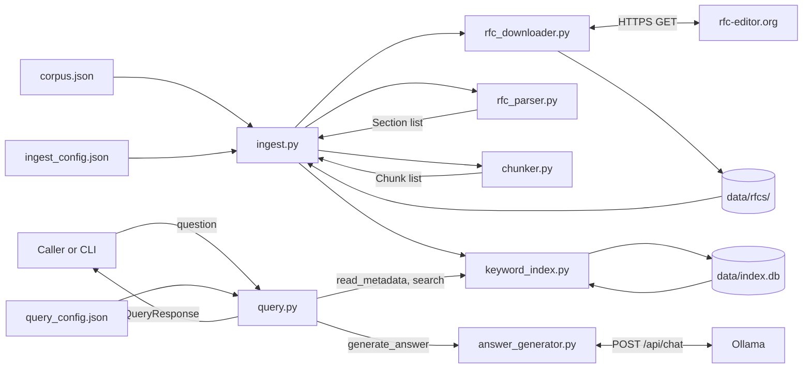
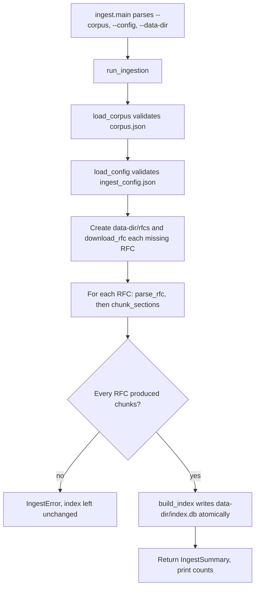
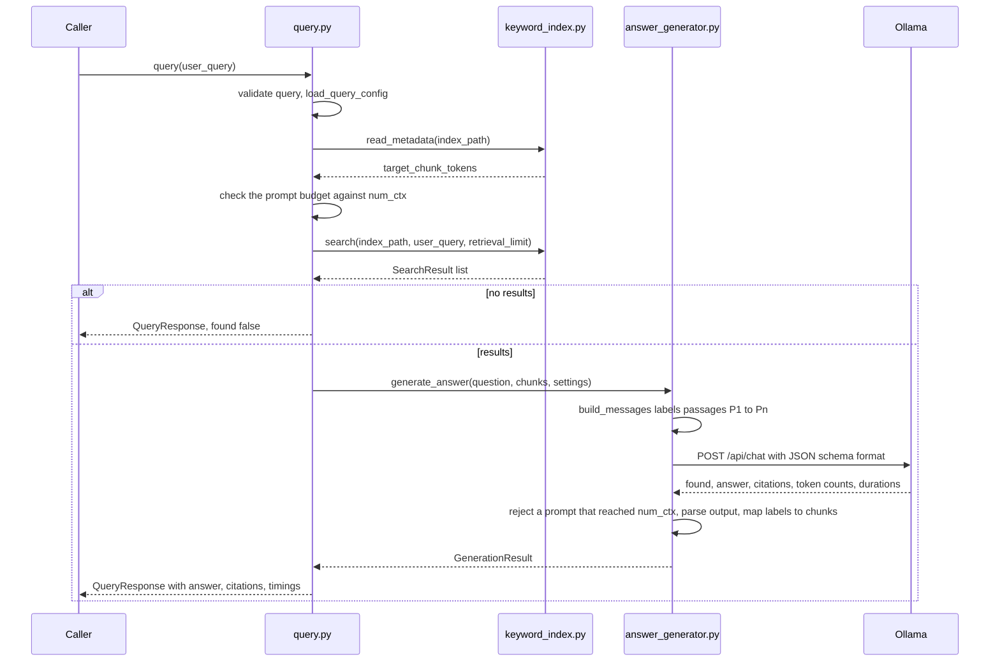
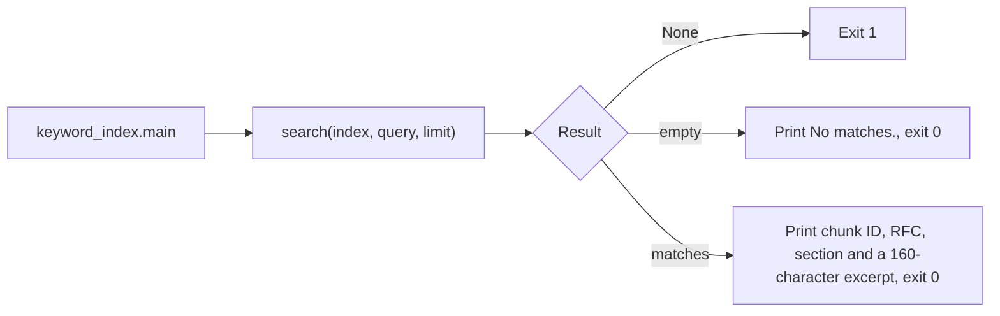
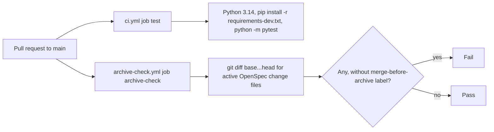
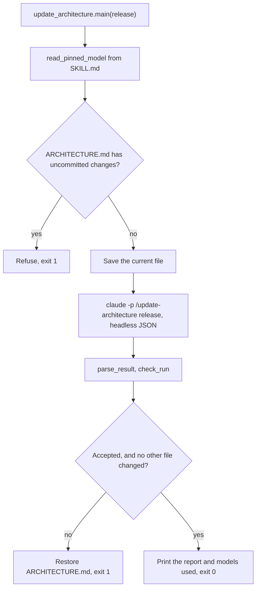

# Architecture

Generated from commit d0517bb by claude-opus-5-5, for release v0.1.0.

## Overview

The Document Q&A Service answers natural-language questions about a curated set of IETF RFCs, and
cites the RFC sections each answer came from. It is a retrieval-augmented generation (RAG) pipeline
written by hand in plain Python modules at the repository root, with `requests` as its only runtime
dependency.

The system has two halves that share one file, the index at `data/index.db`:

- **Ingestion (offline).** `ingest.py` reads the manifest `corpus.json` and the chunk settings in
  `ingest_config.json`. It downloads any missing RFC text from rfc-editor.org with
  `rfc_downloader.py`, splits each RFC into sections with `rfc_parser.py`, cuts sections into
  citable chunks with `chunker.py`, and writes every chunk to a SQLite FTS5 keyword index with
  `keyword_index.py`. The index also records the configuration that built it.
- **Querying (online).** `query.py` is the main entry point. For each question it reads
  `query_config.json`, checks that the retrieved passages and answer will fit the model's context
  window, retrieves the best-matching chunks with keyword search, and passes them to
  `answer_generator.py`. That module asks a local model served by Ollama to answer from those
  passages only, as structured JSON, then maps the passages the model cited back to the retrieved
  chunks. `query.py` returns the answer, its citations and timings in a `QueryResponse`.

A citation check proves that a cited passage was retrieved. It can't prove that the passage
supports the answer.

Two further pieces support development: GitHub Actions workflows in `.github/workflows/` that gate
pull requests, and `scripts/update_architecture.py`, which regenerates this file with a pinned model.

## Workflows

### Building the index

1. `ingest.main` parses the command line and calls `run_ingestion(corpus_path, config_path,
   data_dir)`. Any `IngestError` is printed to stderr and the exit status is 1.
2. `load_corpus` reads `corpus.json` and returns a list of `CorpusEntry`. Each entry needs a positive
   integer `number`, a `family` from `FAMILIES` (`http`, `tls`, `tcp`) and a non-empty `title`. A
   repeated number is an error.
3. `load_config` reads `ingest_config.json` and returns an `IngestConfig`. `target_chunk_tokens` may
   not exceed `embedding_model.max_tokens`. `IngestConfig.max_chunk_chars` is
   `int(target_chunk_tokens * chars_per_token)`.
4. Ingestion creates `<data-dir>/rfcs/` if needed and calls `download_rfc(number, directory)` for
   every RFC whose `rfc<number>.txt` is missing. A failed download stops the run.
   `download_rfc` fetches `https://www.rfc-editor.org/rfc/rfc<number>.txt`, verifies a 200 status, a
   non-empty body, the `Content-Length` when present and that the document head names the requested
   RFC, then writes the file through a temporary file and `os.replace`.
5. For each RFC in manifest order, the text is read as UTF-8 (undecodable bytes replaced) and passed
   to `parse_rfc`, which calls `remove_page_furniture` and returns the retained `Section` objects.
   `chunk_sections` then splits each section with `split_text` and returns `Chunk` objects carrying
   the manifest's title and family. An RFC that produces no chunks stops the run.
6. Only after every RFC has produced chunks, `build_index(chunks, config.as_metadata(), path)` writes
   a new SQLite database to a temporary file in the same directory and moves it over
   `<data-dir>/index.db`. On failure the old index is kept.
7. `run_ingestion` returns an `IngestSummary`, and `main` prints the RFC count, chunk count and
   largest chunk size.

### Answering a question

1. `query(user_query)` rejects anything that isn't a string with a non-whitespace character, with
   `QueryErrorCode.INVALID_QUERY`.
2. `load_query_config(CONFIG_PATH)` reads `query_config.json` and returns a `QueryConfig`, or the
   query fails with `CONFIG_INVALID`. Neither of these first two failures carries timings.
3. A wall clock starts. `read_metadata` supplies the index's `target_chunk_tokens`. If the index or
   that value can't be read, the query fails with `INDEX_UNAVAILABLE`.
4. The budget check requires `retrieval.limit x target_chunk_tokens + PROMPT_ALLOWANCE_TOKENS (512) +
   llm.max_answer_tokens` to be no more than `llm.num_ctx`, or the query fails with
   `CONFIG_INVALID` before any search or model call.
5. `search(index_path, user_query, retrieval_limit)` returns up to `limit` `SearchResult` objects,
   timed as `retrieval_ms`. `None` means `INDEX_UNAVAILABLE`. An empty list returns a successful
   not-found response without calling the model.
6. `generate_answer(question, chunks, settings)` builds the messages with `build_messages`, which
   sends `SYSTEM_PROMPT` and then the passages labeled `P1`, `P2` and so on in retrieval order, each
   with its RFC number, section number and section title, followed by the question. It posts one
   non-streaming request to `<base_url>/api/chat` with `temperature` 0, `num_ctx`, `num_predict` set
   to `max_answer_tokens`, and a JSON schema requiring `found`, `answer` and `citations`.
   - A timeout, refused connection, missing model (HTTP 404 with "not found") or other non-200 status
     raises `ModelUnavailableError`, which becomes `MODEL_UNAVAILABLE`.
   - A response that isn't JSON, output without the expected fields, or a `prompt_eval_count` at or
     above `num_ctx` raises `ModelResponseError`, which becomes `MODEL_INVALID_RESPONSE`.
7. Cited labels are matched exactly, ignoring surrounding whitespace, against the labels sent.
   Unknown labels and repeats are dropped, keeping the order first cited. The result counts as
   answered only if the model said `found`, the answer text is non-empty and at least one citation
   is valid. Otherwise the answer text is discarded.
8. `query` builds `Timings` from the wall clock and Ollama's `load_duration`, `prompt_eval_duration`,
   `eval_duration`, `prompt_eval_count` and `eval_count`. `cold_start` is true when the model load
   took at least `COLD_START_THRESHOLD_MS` (500 ms).
9. An answered result returns `success` true, `found` true, the answer and one `Citation` per cited
   chunk. A not-answered result returns `success` true, `found` false and `NOT_FOUND_ANSWER`.

`query.main` prints the answer and a `Sources:` list, and adds a note when the answer was a cold
start. It prints the error to stderr and exits with status 1 on failure.

### Searching the index from the command line

`search` opens the index read-only and reports a missing file instead of creating one. It splits
the query text into word tokens, quotes each one and joins them with `OR`, so that user text is never
read as FTS syntax. It ranks with BM25, weighting a match in the section title 10 times a match in
the body, breaks ties by chunk ID, and returns the negated BM25 value as `score`, so a higher score
is a better match. Once the index is open, text with no word tokens, or a `limit` of 0 or less,
returns an empty list.

### Checking a pull request

- `.github/workflows/ci.yml` runs the `test` job on pull requests to `main` and on pushes to `main`.
  It installs `requirements-dev.txt` on Python 3.14 and runs `python -m pytest`. Tests marked
  `integration` and `ollama` in `pytest.ini` need `RFC_DOWNLOADER_NETWORK_TESTS=1` and
  `OLLAMA_TESTS=1`, which CI doesn't set.
- `.github/workflows/archive-check.yml` runs the `archive-check` job on pull requests to `main`,
  including label changes. It fails when the pull request adds or modifies files under
  `openspec/changes/` outside `openspec/changes/archive/`, unless the pull request has the
  `merge-before-archive` label.

Both workflows set `permissions: contents: read`.

### Regenerating ARCHITECTURE.md

1. `main` rejects an empty release or one containing whitespace, then calls
   `update_architecture(ROOT, release)`.
2. `read_pinned_model` reads the `model:` field from the frontmatter of
   `.claude/skills/update-architecture/SKILL.md`, and requires a full model ID rather than an alias.
3. The script records the changed and untracked files from `git status`, and refuses to run if
   `ARCHITECTURE.md` is among them. It saves the file's current content, if any.
4. It runs `claude -p "/update-architecture <release>" --model <pinned> --output-format json` with
   the tools in `ALLOWED_TOOLS` and `--permission-mode acceptEdits`.
5. `parse_result` takes the last JSON object in the output. `check_run` accepts the run only if the
   exit status is 0, `is_error` is false, the pinned model appears in `modelUsage`, and it produced
   more output tokens than every other model listed.
6. Any file other than `ARCHITECTURE.md` that changed during the run rejects it, and those files
   are listed but left as they are.
7. On rejection, `ARCHITECTURE.md` is restored, or deleted if it didn't exist, and an
   `ArchitectureError` is printed. On acceptance the run's report is printed with the models used.

## Public interfaces

### Query API (`query.py`)

`query(user_query) -> QueryResponse` answers one question. Expected failures are returned in the
response, not raised. It reads `query_config.json` from the repository root on every call.

`QueryResponse` (mutable dataclass):

| Field | Type | Meaning |
|---|---|---|
| `success` | `bool` | Whether the query completed, including a not-found result |
| `answer` | `Optional[str]` | The answer, or `NOT_FOUND_ANSWER` when not found, or `None` on failure |
| `found` | `Optional[bool]` | Whether the indexed RFCs answered the question; `None` on failure |
| `citations` | `List[Citation]` | Cited sections, in the order first cited; empty unless `found` |
| `timings` | `Optional[Timings]` | `None` only when validation or configuration loading fails |
| `error_string` | `Optional[str]` | A message for people, on failure |
| `error_code` | `Optional[QueryErrorCode]` | The failure kind, on failure |

`Citation` (frozen dataclass): `chunk_id: str`, `rfc_number: int`, `rfc_title: str`,
`section_number: str`, `section_title: str`.

`Timings` (frozen dataclass): `total_ms: int`, then `retrieval_ms`, `model_load_ms`,
`generation_ms`, `prompt_tokens` and `answer_tokens`, all `Optional[int]` and `None` when that stage
didn't run, and `cold_start: bool`. `generation_ms` is Ollama's prompt evaluation plus generation
time.

`QueryErrorCode` (`IntEnum`). Its docstring says values may be renumbered until the first release,
and that after it a removed value is retired and not reused.

| Member | Value | Raised when |
|---|---|---|
| `INVALID_QUERY` | 1 | The query isn't a string with a non-whitespace character |
| `INDEX_UNAVAILABLE` | 2 | The index, its metadata or its search can't be read |
| `MODEL_UNAVAILABLE` | 3 | Ollama can't be reached, times out, lacks the model or returns an HTTP error |
| `MODEL_INVALID_RESPONSE` | 4 | Ollama's output isn't usable JSON, or the prompt reached `num_ctx` |
| `CONFIG_INVALID` | 5 | `query_config.json` is invalid, or the prompt budget doesn't fit `num_ctx` |

`NOT_FOUND_ANSWER`, defined in `answer_generator.py`, is the text "The indexed RFCs don't answer
this question."

### Command lines

| Command | Arguments | Output and exit status |
|---|---|---|
| `python ingest.py` | `--corpus` (default `corpus.json`), `--config` (default `ingest_config.json`), `--data-dir` (default `data/`), all relative to the repository root | Prints RFC count, chunk count and largest chunk; exits 0, or 1 with a message on stderr |
| `python query.py QUERY` | `query`: the question | Prints the answer, `Sources:` and any cold-start note; exits 0, including not found, or 1 with the error on stderr |
| `python keyword_index.py QUERY` | `query`: the search text; `--index` (default `data/index.db`); `--limit` (default 5) | Prints each match's chunk ID, RFC, section and an excerpt, or `No matches.`; exits 1 only if the index can't be read |
| `python scripts/update_architecture.py RELEASE` | `release`: one word, such as `v0.1.0` | Prints the run's report and models used; exits 0 when kept, or 1 when refused or rejected |

### Configuration and data files

`corpus.json` lists the RFCs to index, as `{"rfcs": [...]}`. The list must be non-empty, with no
number repeated. It holds 59 RFCs today.

| Field | Type | Rule |
|---|---|---|
| `number` | integer | Greater than 0; not a boolean |
| `family` | string | One of `http`, `tls`, `tcp` |
| `title` | string | Non-empty; used as the RFC title in chunks and citations |

`ingest_config.json` sets the chunk size limit.

| Field | Type | Value today | Rule |
|---|---|---|---|
| `embedding_model.name` | string | `nomic-embed-text` | Non-empty; recorded in the index only |
| `embedding_model.max_tokens` | integer | 2048 | Positive; ceiling for `target_chunk_tokens` |
| `chars_per_token` | number | 1.6 | Positive |
| `target_chunk_tokens` | integer | 1100 | Positive, at most `max_tokens` |

The maximum chunk size is `int(target_chunk_tokens x chars_per_token)` characters, 1,760 today.

`query_config.json` sets retrieval and model settings.

| Field | Type | Value today | Rule |
|---|---|---|---|
| `index_path` | string | `data/index.db` | Non-empty; a relative path is resolved from the repository root |
| `retrieval.limit` | integer | 5 | Positive; passages retrieved per query |
| `llm.model` | string | `llama3.2` | Non-empty; Ollama model name |
| `llm.base_url` | string | `http://localhost:11434` | Non-empty; Ollama address |
| `llm.num_ctx` | integer | 8192 | Positive; context window requested from Ollama |
| `llm.max_answer_tokens` | integer | 512 | Positive; sent as `num_predict` |
| `llm.timeout_seconds` | number | 120 | Positive; request timeout |

Generated files, git-ignored under `data/`:

- `data/rfcs/rfc<number>.txt`: the downloaded RFC text, exactly as served.
- `data/index.db`: a SQLite database with a `metadata` table (`key`, `value`, both text) holding the
  `IngestConfig.as_metadata()` values (`embedding_model_name`, `embedding_max_tokens`,
  `chars_per_token`, `target_chunk_tokens`, `max_chunk_chars`), a `chunks` table with one row per
  chunk, holding an integer `id` and a column for each `Chunk` field, and an external-content FTS5 table `chunks_fts` over `section_title` and `text` with
  the `porter unicode61` tokenizer.

Chunk IDs have the form `rfc<number>-s<section>[-<n>]-p<position>`, for example
`rfc9110-s15.5.5-p0`. `<position>` counts from 0 within a section. When an RFC repeats a section
number, the second and later sections with that number get `-2`, `-3` and so on. The unnumbered `Abstract` and `Security
Considerations` sections use the section numbers `abstract` and `security`.

## Internal interfaces

### `rfc_downloader.py`

- `download_rfc(rfc_number, directory) -> bool`: stores the RFC as `<directory>/rfc<number>.txt`.
  Returns `True` on success or when the file already exists, and `False` with a message on stderr
  for a non-positive or non-integer number, a missing directory, a network or HTTP error, or a
  failed verification or write. It doesn't create the directory.
- `RFC_URL_TEMPLATE`: `https://www.rfc-editor.org/rfc/rfc{number}.txt`.
- `HTTP_TIMEOUT`: `(10, 30)`, the connect and read timeouts in seconds.

### `rfc_parser.py`

- `Section` (frozen dataclass): `number: str`, `title: str`, `text: str`. `text` keeps the source
  line layout and can be empty.
- `remove_page_furniture(text) -> str`: normalizes line endings, and where the text has form feeds,
  removes page headers, `[Page n]` footers and the blank lines around each break.
- `parse_rfc(text) -> list[Section]`: returns the retained sections in document order. Front matter,
  the table of contents, and back matter such as references, acknowledgments, author addresses and
  the index are dropped, including the subsections of a dropped numbered section.

### `chunker.py`

- `Chunk` (frozen dataclass): `chunk_id: str`, `rfc_number: int`, `rfc_title: str`, `family: str`,
  `section_number: str`, `section_title: str`, `text: str`.
- `split_text(text, max_chars) -> list[str]`: returns parts of at most `max_chars`, packing
  paragraphs greedily, then lines for an oversized paragraph, and cutting a line only when it can't
  fit alone. Whitespace-only text no longer than `max_chars` returns an empty list. There is no
  overlap.
- `chunk_sections(sections, rfc_number, rfc_title, family, max_chars) -> list[Chunk]`: chunks one
  RFC's sections and assigns chunk IDs. Sections with no body text produce no chunks.

### `keyword_index.py`

All SQL in the project is in this module.

- `SearchResult` (frozen dataclass): `chunk: Chunk`, `score: float`, where higher is better.
- `build_index(chunks, metadata, path) -> bool`: writes a new index from a list of `Chunk` and a
  dict of metadata, replacing `path` atomically. Returns `False` with a message on stderr on failure,
  leaving any existing index and no temporary file.
- `read_metadata(path) -> dict | None`: returns the `metadata` table, with string values, or `None`
  if the index is missing or unreadable.
- `search(path, query_text, limit=DEFAULT_LIMIT) -> list[SearchResult] | None`: returns up to
  `limit` results, best first, an empty list when nothing matches, or `None` if the index can't be
  read or searched.
- `main(argv=None) -> int`: the search command line.
- `DEFAULT_INDEX_PATH` (`data/index.db` under the repository root) and `DEFAULT_LIMIT` (5).

### `ingest.py`

- `IngestError`: an exception with a message ready to show.
- `CorpusEntry` (frozen dataclass): `number: int`, `family: str`, `title: str`.
- `IngestConfig` (frozen dataclass): `embedding_model_name: str`, `embedding_max_tokens: int`,
  `chars_per_token: float`, `target_chunk_tokens: int`. The property `max_chunk_chars` returns the
  limit in characters, and `as_metadata()` returns the dict that `build_index` stores.
- `IngestSummary` (frozen dataclass): `rfc_count: int`, `chunk_count: int`,
  `largest_chunk_chars: int`.
- `load_corpus(path) -> list[CorpusEntry]` and `load_config(path) -> IngestConfig`: validate a file,
  raising `IngestError`.
- `run_ingestion(corpus_path, config_path, data_dir) -> IngestSummary`: the whole build, raising
  `IngestError`.
- `main(argv=None) -> int`: the ingestion command line.
- `FAMILIES`, `DEFAULT_CORPUS_PATH`, `DEFAULT_CONFIG_PATH` and `DEFAULT_DATA_DIR`.

### `answer_generator.py`

- `ModelSettings` (frozen dataclass): `model: str`, `base_url: str`, `num_ctx: int`,
  `max_answer_tokens: int`, `timeout_seconds: float`.
- `GenerationResult` (frozen dataclass): `found: bool`, `answer: Optional[str]`, `cited: list` of
  the cited `Chunk` objects, then `model_load_ms`, `generation_ms`, `prompt_tokens` and
  `answer_tokens`, each `Optional[int]`. When `found` is false, `answer` is `None` and `cited` is
  empty.
- `ModelUnavailableError` and `ModelResponseError`: exceptions whose messages are shown to the user.
  The first includes a setup hint, such as `ollama serve` or `ollama pull <model>`.
- `build_messages(question, chunks) -> list[dict]`: the system and user chat messages.
- `generate_answer(question, chunks, settings) -> GenerationResult`: one model call, with checked
  citations. Raises either exception above when no usable answer comes back.
- `SYSTEM_PROMPT` and `NOT_FOUND_ANSWER`.

### `query.py`

Besides the public API above:

- `QueryConfig` (frozen dataclass): `index_path: str`, `retrieval_limit: int`,
  `model: ModelSettings`.
- `QueryConfigError`: an exception naming the invalid value.
- `load_query_config(path) -> QueryConfig`: validates `query_config.json`, raising
  `QueryConfigError`.
- `main(argv=None) -> int`: the query command line.
- `CONFIG_PATH`, `PROMPT_ALLOWANCE_TOKENS` (512) and `COLD_START_THRESHOLD_MS` (500).

### `scripts/update_architecture.py`

- `ArchitectureError`: a reason not to run, or not to keep a result.
- `read_pinned_model(skill_path) -> str`: the full model ID from the skill's frontmatter.
- `parse_result(stdout) -> dict | None`: the last JSON object in headless output.
- `describe_usage(result) -> str`: each model in `modelUsage` with its output tokens.
- `check_run(exit_code, result, pinned_model) -> str | None`: `None` to keep the run, otherwise the
  reason to reject it.
- `update_architecture(root, release) -> str`: runs the skill and returns its report, raising
  `ArchitectureError` after restoring `ARCHITECTURE.md`.
- `main(argv=None) -> int`: the command line.
- `ROOT`, `SKILL_RELATIVE_PATH`, `DOC_RELATIVE_PATH` and `ALLOWED_TOOLS`.

## Key decisions

| Decision | Why | Assumption to revisit | Status | Last reviewed | Source |
|---|---|---|---|---|---|
| RFCs come only from rfc-editor.org plaintext, verified by `Content-Length` and the RFC number in the header | The canonical source is authoritative and already plaintext. It publishes no checksum, so these checks catch truncation and wrong documents | rfc-editor.org keeps serving `rfc<n>.txt` with a `Content-Length` header, and still publishes no checksum | New | - | [add-rfc-downloader design](openspec/changes/archive/2026-11-07-add-rfc-downloader/design.md) |
| `corpus.json` records number, family and title, and no status | A manifest is easy to review. Cover pages vary too much to read titles from. Status needs its own source of truth | Status-aware retrieval still hasn't been built, and the 59 RFCs and their obsolete pairs still match the RFC Editor's index | New | - | [add-rfc-ingestion design](openspec/changes/archive/2026-11-07-add-rfc-ingestion/design.md) |
| Section headings are found by shape and by section order, with fixed lists of unnumbered titles | Order rejects numbered lists without a rule per era. Tested against all 59 RFCs, with a fixture for each layout | The corpus uses only the four layouts sampled, and no new RFC breaks the order or title rules | New | - | [add-rfc-ingestion design](openspec/changes/archive/2026-11-07-add-rfc-ingestion/design.md) |
| Chunk size is a character limit derived from `ingest_config.json`, so ingestion doesn't need Ollama | Keeps ingestion, tests and CI free of a model service, and keeps the hard ceiling apart from the tunable target | No embeddings are made yet. Once they are, `max_tokens` should be checked against Ollama and `truncate: false` passed | New | - | [add-rfc-ingestion design](openspec/changes/archive/2026-11-07-add-rfc-ingestion/design.md) |
| `chars_per_token` is 1.6 | The lowest ratio measured across every chunk, rounded down, because dense ASCII tables reached 1.67 | Same corpus and embedding model, and dense tables still justify smaller chunks for everything | New | - | [add-rfc-ingestion design](openspec/changes/archive/2026-11-07-add-rfc-ingestion/design.md) |
| Chunks split at paragraphs, then lines, with no overlap, and IDs like `rfc9110-s15.5.1-p0` derived from the document | Overlap adds near-duplicate text. Document-derived IDs are readable and stable for citations | The golden set doesn't show a need for overlap or semantic chunking, and nothing outside stores chunk IDs that a format change would break | New | - | [add-rfc-ingestion design](openspec/changes/archive/2026-11-07-add-rfc-ingestion/design.md) |
| SQLite FTS5 with BM25 for keyword search, in one index file | One file, BM25 built in and no new dependency. `rank_bm25` needs a dependency and loads everything into memory | Local Chroma still lacks BM25, as of chromadb 1.5.9, and FTS5 is present in every Python build used | New | - | [add-rfc-ingestion design](openspec/changes/archive/2026-11-07-add-rfc-ingestion/design.md) |
| The retrieval boundary is `build_index` and `search`, with all SQL in `keyword_index.py` | Keyword, vector and hybrid search differ in inputs and scores, so a generic database interface wouldn't fit. A formal interface waits for a second backend | Only one retrieval backend exists | New | - | [add-rfc-ingestion design](openspec/changes/archive/2026-11-07-add-rfc-ingestion/design.md) |
| Ollama's `/api/chat` is called directly with `requests`, using a JSON schema for structured output | One request, no new dependency, and the spike showed the schema produces valid JSON reliably | Ollama's structured output stays reliable for the configured model, and its API keeps the `format` field and duration fields | New | - | [add-answer-generation design](openspec/changes/archive/2026-11-07-add-answer-generation/design.md) |
| Passages are labeled `P1` to `Pn`, and code maps cited labels back to chunks | The only format where good answers cited correctly in the spike. Full IDs broke good answers | `llama3.2` remains the model. A citation proves retrieval, not support, and invented answers can cite real labels | New | - | [add-answer-generation design](openspec/changes/archive/2026-11-07-add-answer-generation/design.md) |
| Not found is a success, and an answer with no valid citations is treated as not found | The system worked correctly, and step 2 can score not found separately from failures | Callers and evaluation still treat not found as an outcome rather than an error | New | - | [add-answer-generation design](openspec/changes/archive/2026-11-07-add-answer-generation/design.md) |
| The prompt budget is checked before the model call, using `target_chunk_tokens` from the index, and a `prompt_eval_count` at `num_ctx` fails the query | Ollama shortens an over-long prompt without an error, so the service must not answer from a partial prompt | The 512-token allowance covers the instructions and question, and Ollama still truncates silently and reports `prompt_eval_count` | New | - | [add-answer-generation design](openspec/changes/archive/2026-11-07-add-answer-generation/design.md) |
| `QueryErrorCode` values are renumbered until the first release, and retired after it | No outside caller depended on old values before a release, and consecutive values are simpler | No release has happened. v0.1.0 is the first release, so from it on a removed value must be retired | New | - | [add-answer-generation design](openspec/changes/archive/2026-11-07-add-answer-generation/design.md) |
| Ollama loads the model on demand, and a load of at least 500 ms marks a cold start | A preliminary check would add a call to every query, and the request already reports its load time | Measured loads stay far from 500 ms: about 2 ms warm and 4,852 ms cold. `keep_alive` stays at Ollama's default | New | - | [add-answer-generation design](openspec/changes/archive/2026-11-07-add-answer-generation/design.md) |
| `scripts/update_architecture.py` enforces the pinned model by checking `modelUsage` after a headless run | A skill's `model` field fails open when a policy blocks the model, and a fallback model can take over | Claude Code skills still can't refuse to run on a model mismatch. A helper model may still appear in `modelUsage`, but with less output | New | - | [add-architecture-generator design](openspec/changes/add-architecture-generator/design.md) |
